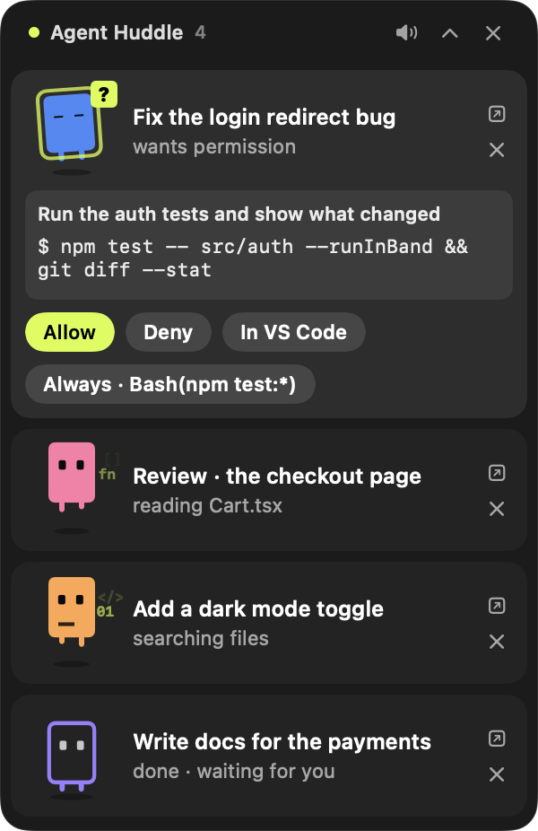

# Agent Huddle

A small floating window for your Mac that shows every Claude Code session you have running as a little bot,
and lets you answer their permission prompts and questions without hunting for the right tab.



- **One bot per session**, in any folder: working, waiting for you, or done.
- **Allow / Deny from the widget.** The card shows the full command, or the file edit as a red/green diff, plus Claude Code's own "always allow" options.
- **Answer Claude's multiple-choice questions** right in the widget (single and multi-select).
- **Whoever needs you jumps to the top**, with a sound (mute button in the header).
- **↗ jumps to the session** (VS Code tab, Terminal, iTerm, the Claude desktop app). **×** closes it in VS Code.
- **Click a bot** to see what it's doing live: commands, file edits, searches.

Nothing leaves your Mac: the widget only listens on `127.0.0.1`.

## Works with

| | |
|---|---|
| ✅ Claude Code in the terminal | Terminal, iTerm and others |
| ✅ Claude Code in VS Code | chat panel and terminal |
| ✅ Claude desktop app | the Code tab, "This computer" sessions |
| ❌ Cloud sessions | they run on Anthropic's servers, so they can't reach a widget on your Mac |

**Mac only** (macOS 13 Ventura or newer). Windows and Linux aren't supported. If you'd like to make your own
version for them, the [How it talks](#how-it-talks) section explains how the pieces connect.

## Install

You need:
- **Xcode Command Line Tools** (for `swiftc`): `xcode-select --install`
- **Node.js 18+** (Claude Code's hooks run `hook.js` with it)
- Claude Code

```bash
git clone https://github.com/helloaiwithalex-oss/agent-huddle.git
cd agent-huddle
./install.sh
```

The installer:
1. builds the app from source and puts it in `~/Applications/Agent Huddle.app`
2. copies `hook.js` to `~/.agent-huddle/`
3. adds its hooks to `~/.claude/settings.json`, leaving your other settings as they are (a backup is saved as `settings.json.agent-huddle-backup`; running it again never adds duplicates)
4. starts the widget now and at every login
5. installs the small VS Code helper, if VS Code is installed

Then **start a new Claude Code session** (sessions that were already open don't see new hooks) and a bot appears.

Updating: `git pull && ./install.sh`. Removing: `./uninstall.sh` (takes out everything above, your other settings stay).

## Using it

- **A card pops up** when a session asks for permission. Allow, Deny, an "Always …" option, or **In VS Code / In Terminal / …** to answer it there instead. If you don't answer in the widget, Claude's normal prompt is still there.
- **Drag** the window anywhere. The **⌃** in the header shrinks it to a single row. The header's **×** quits the widget until your next login (open it again from `~/Applications`).
- **↗** brings the session's app to the front (and the exact tab in VS Code).
- **×** closes the session's tab in VS Code. For Terminal and the desktop app it only removes the bot from the list: other apps can't close their tabs or chats from outside, so close them there and the bot leaves on its own within a few seconds.
- In auto mode Claude rarely asks, so you'll mostly see cards in the default (ask) mode.

### The VS Code helper

VS Code doesn't let outside apps switch or close its tabs, so a tiny extension (`vscode-ext/`, under 100 lines,
installed by `install.sh`) does it: the widget drops a request file in `~/.agent-huddle/commands/` and the
extension carries it out. Reload VS Code windows after installing. Everything else works without it.

## Privacy and security

- Everything stays on your Mac. The widget listens on `127.0.0.1` only, on a random port, and every request needs a random token that's regenerated on each start. Both are in `~/.agent-huddle/server.json`, readable only by you.
- The hook sends the widget what Claude Code gives every hook (tool name and input, session id, folder). The widget reads the session's own transcript file to show names and live activity. Nothing is stored, apart from the small files in `~/.agent-huddle/`.
- If the widget isn't running, the hook exits immediately and Claude Code carries on as normal.

## FAQ

**Two agents asking at the same moment: do they queue?**
No. Each session gets its own card at the same time, and whoever is waiting moves to the top. If one session asks several things at once, they show one after another with "+N more".

**Does it show the full command, or just the tool name?**
The full command (it scrolls if it's long), and file edits as the actual change in red and green.

**Does it slow Claude down?**
Each hook takes about 0.1 s. Permission requests wait for your answer, up to 10 minutes, then Claude's normal prompt takes over.

## How it works

```
Claude Code ──hook event──▶ hook.js ──HTTP 127.0.0.1──▶ Agent Huddle.app
                         ◀── allow / deny ◀──────────── (you click)
Agent Huddle.app ──request file──▶ ~/.agent-huddle/commands/ ──▶ VS Code helper (jump / close)
```

| File | What it is |
|---|---|
| `app/main.swift` | the widget (SwiftUI, one file) |
| `hook.js` | the hook Claude Code runs on every event |
| `hooks.mjs` | adds/removes the hooks in `~/.claude/settings.json` |
| `install.sh` / `uninstall.sh` / `build.sh` | install, remove, build |
| `vscode-ext/` | the VS Code helper |
| `test/sim.mjs` | stress test: fake sessions against a separate copy of the widget |

### How it talks

For anyone building a port, or another front end:

1. On start, the widget writes `~/.agent-huddle/server.json`: `{"port": 51234, "token": "…", "pid": 123}`.
2. For every hook event, `hook.js` POSTs Claude Code's hook JSON to `http://127.0.0.1:<port>/event` with `Authorization: Bearer <token>`, plus a few fields of its own: `claude_pid`, `claude_ppid`, `panel` (VS Code chat panel), `desktop` (Claude desktop app) and `app_id` (the app the session runs in, such as `com.apple.Terminal`).
3. Every event gets an immediate reply, except `PermissionRequest`: the widget holds that request open until you click, then replies `{"decision": "allow" | "deny"}`, optionally with `updatedInput` (answers to a question) or `updatedPermissions` (an "Always" option). No decision means Claude's normal prompt. `{"retry": true}` means the widget is shutting down, and the hook asks the next one.
4. `hook.js` turns the decision into Claude Code's `PermissionRequest` hook output.

## Develop

```bash
./build.sh                                                   # build next to the source
node test/sim.mjs "$PWD/Agent Huddle.app/Contents/MacOS/AgentHuddle"   # 43 checks, report in test/results/
./install.sh                                                 # install what you built
```

Debug log: `touch ~/.agent-huddle/log-events` writes one line per hook event to `~/.agent-huddle/events.log`
(no tool input). `rm` it to stop.

## Contributing

This project is shared as is, and I'm not taking pull requests or feature requests. You're very welcome to
fork it and change your own copy however you like.

## License

MIT. See [LICENSE](LICENSE).
